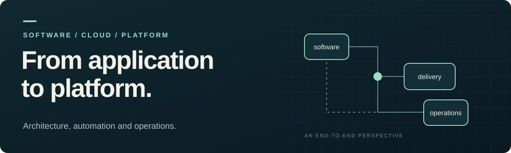

**English** | [Português (Brasil)](pt-BR/README.md)

# Guilherme Martins

**Senior Cloud Platform Engineer** 
Software engineering · AWS · Kubernetes · Developer Experience · Observability

My career connects software development, infrastructure and operations. With a strong foundation in **C#/.NET and Node.js**, I build platforms, automation and standards that help teams develop, deliver and operate applications.

At **Conexia Educação**, I provide technical guidance across teams: I contribute to architecture decisions, build reference implementations, document solutions and support their adoption. I enjoy understanding problems end to end and building mechanisms that prevent them from recurring.

[Explore my background →](PROFILE.md) · [Read the technical cases →](TECHNICAL-PROJECTS.md)

---

## Results in context

| Area | Reported improvement |
| :--- | :--- |
| [**Delivery**](TECHNICAL-PROJECTS.md#p01--transformacao-do-processo-de-entrega) | **Quarterly → weekly or every two weeks** More frequent deployments through pipelines, code review and delivery standards. |
| [**Kubernetes**](TECHNICAL-PROJECTS.md#p02--padroes-de-infraestrutura-kubernetes) | **~4–5 days → ~1–2 days** Less time preparing infrastructure through reusable components. |
| [**Database**](TECHNICAL-PROJECTS.md#p09--escala-de-banco-e-separacao-de-leituraescrita) | **More than 50% less load** The combined result of resizing and separating read and write access. |

Results reported during the experience review. Each case records its scope, approximations and limitations.

## How I work

**Architecture grounded in context.** I assess the need, cost, security, performance and operational requirements before choosing services or adding complexity to a solution.

**Platforms that support teams.** I turn recurring solutions into Kubernetes, pipeline, configuration and observability standards, as well as internal tools, with documentation and examples.

**End-to-end troubleshooting.** I connect application behavior, telemetry, infrastructure and databases to investigate failures and guide improvements.

## Explore the knowledge base

| Document | What it covers |
| :--- | :--- |
| **[01 · Professional profile](PROFILE.md)** | Career history, capabilities, working approach, education and career direction. |
| **[02 · Technical projects](TECHNICAL-PROJECTS.md)** | 12 case and practice records: context, contribution, decisions, results and details. |
| **[03 · Review roadmap](ROADMAP.md)** | Topics already explored and the exact point for continuing the review. |
| **[04 · Ideas and pending items](IDEAS-AND-PENDING.md)** | Initiatives, gaps and decisions that still need confirmation. |
| **[05 · History](HISTORY.md)** | Sources, reviews and decisions supporting the content. |

This README is the entry point to **six Markdown documents in each language**. English is the default at the repository root; the complete [Brazilian Portuguese version](pt-BR/README.md) is in `pt-BR/`.

## Building the profile

**6 of 10 topics reviewed · 60%** 
Next conversation: **[Networking / Multi-account](ROADMAP.md#6-networking--multi-account)**.

The profile and cases already contain the consolidated material. Further reviews will build on this base. The recorded current job title remains **Senior Platform Engineer (SRE / DevOps)**; **Senior Cloud Platform Engineer** is the chosen professional positioning.

<strong>How this knowledge base is maintained</strong>

This repository is the **source of truth** for the professional profile, including reviews, confirmations and pending items. The résumé, LinkedIn profile and other materials will be derived from it. Work is versioned on the **develop** branch of `guihmartins`, with a local checkout at `/home/guilherme/repositorios/pessoal/guihmartins`.

Both language versions represent the same content. Reviews can continue in Portuguese; confirmed changes must be reflected in both versions in the same commit. Each document links to its counterpart in the other language.

### Preserved material

Five experience documents were consolidated, including the Kubernetes, CI/CD and Security reviews, the October 13 architecture governance discussion and the October 15 completion of Databases. The [sources and reconciliations](HISTORY.md#fontes-de-referencia) remain identified. The consolidation covers the records that were located; it is not a complete recovery of every voice conversation.

Metrics retain their scope and approximations. Importing, reorganizing or translating an account does not validate it again. Staff/Principal assessment remains open.

### Continuity

Consult the [Roadmap](ROADMAP.md) before resuming a topic. Explore the remaining Networking / Multi-account gaps, building on what is already recorded.

### Update workflow

1. Read the existing content and identify the point of review.
2. Incorporate new confirmations into the Profile or Projects, preserving the limits of the account in both languages.
3. Record questions and hypotheses in Pending Items until confirmed.
4. Record the date, topic, source of confirmation and affected documents in History.
5. Update progress when advancement or completion of a topic is confirmed.
6. Check links and language parity, commit to `develop`, and publish to the remote when requested.

Conversations, Library files and ZIPs are source references. Subsequent changes are maintained in the Markdown documents. The imported ZIP does not need updating. The [agent instructions](AGENTS.md) guide future sessions.

---

Guilherme Martins · An evolving professional knowledge base · Updated October 15, 2026
