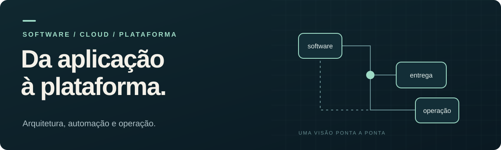

[English](../README.md) | **Português (Brasil)**

# Guilherme Martins

**Senior Cloud Platform Engineer** 
Software engineering · AWS · Kubernetes · Developer Experience · Observabilidade

Minha trajetória conecta desenvolvimento de software, infraestrutura e operação. Com uma base forte em **C#/.NET e Node.js**, atuo na construção de plataformas, automações e padrões que ajudam os times a desenvolver, entregar e operar aplicações.

Na **Conexia Educação**, sou referência técnica transversal: participo de decisões de arquitetura, construo implementações de referência, documento soluções e apoio sua adoção. Gosto de entender o problema de ponta a ponta e criar mecanismos para prevenir sua recorrência.

[Conheça minha trajetória →](PERFIL-CONSOLIDADO.md) · [Explore os casos técnicos →](PROJETOS-TECNICOS.md)

---

## Resultados em contexto

| Frente | Evolução relatada |
| :--- | :--- |
| [**Entrega**](PROJETOS-TECNICOS.md#p01--transformacao-do-processo-de-entrega) | **Trimestral → semanal/quinzenal** Frequência de deploy ampliada com pipelines, revisão de código e padrões de entrega. |
| [**Kubernetes**](PROJETOS-TECNICOS.md#p02--padroes-de-infraestrutura-kubernetes) | **~4–5 dias → ~1–2 dias** Tempo de preparação da infraestrutura reduzido com componentes reutilizáveis. |
| [**Banco**](PROJETOS-TECNICOS.md#p09--escala-de-banco-e-separacao-de-leituraescrita) | **Mais de 50% menos carga** Resultado conjunto de redimensionamento e separação dos acessos de leitura e escrita. |

Resultados relatados nas revisões. Escopo, aproximações e limites estão registrados em cada caso.

## Como eu atuo

**Arquitetura com contexto.** Avalio necessidade, custo, segurança, performance e capacidade de operação antes de escolher serviços ou aumentar a complexidade de uma solução.

**Plataformas que ajudam os times.** Transformo soluções recorrentes em padrões de Kubernetes, pipelines, configuração, observabilidade e ferramentas internas, com documentação e exemplos de uso.

**Diagnóstico de ponta a ponta.** Conecto comportamento da aplicação, telemetria, infraestrutura e banco de dados para investigar falhas e orientar melhorias.

## Explore a base

| Documento | O que você encontra |
| :--- | :--- |
| **[01 · Perfil profissional](PERFIL-CONSOLIDADO.md)** | Trajetória, competências, forma de trabalhar, formação e direção de carreira. |
| **[02 · Projetos técnicos](PROJETOS-TECNICOS.md)** | 12 registros de casos e práticas: contexto, atuação, decisões, resultados e detalhes. |
| **[03 · Roadmap da revisão](ROADMAP.md)** | O que já foi aprofundado e o ponto exato para continuar. |
| **[04 · Ideias e pendências](IDEIAS-E-PENDENCIAS.md)** | Iniciativas, lacunas e decisões que ainda precisam de confirmação. |
| **[05 · Histórico](HISTORICO.md)** | Fontes, revisões e decisões que sustentam o conteúdo. |

Este README é a entrada do conjunto de **seis documentos Markdown por idioma**. O inglês é o padrão na raiz; a versão completa em português brasileiro está em `pt-BR/`.

## Construção do perfil

**6 de 10 blocos revisados · 60%** 
Próxima conversa: **[Networking / Multi-account](ROADMAP.md#6-networking--multi-account)**.

O perfil e os casos já estão preenchidos com o conteúdo consolidado. Os próximos aprofundamentos complementam esta base. O cargo histórico atual permanece **Senior Platform Engineer (SRE / DevOps)**; **Senior Cloud Platform Engineer** é o posicionamento profissional definido.

<strong>Como esta base é mantida</strong>

Este repositório é a **fonte da verdade** do perfil profissional, incluindo revisões, validações e pendências. Currículo, LinkedIn e outros materiais serão derivados daqui. O trabalho é versionado na branch **develop** do repositório `guihmartins`, com cópia local em `/home/guilherme/repositorios/pessoal/guihmartins`.

As duas versões representam o mesmo conteúdo. As revisões podem continuar em português; novas confirmações devem ser refletidas nos dois idiomas no mesmo commit. Cada documento leva diretamente à versão equivalente no outro idioma.

### Conteúdo preservado

Foram reunidos cinco documentos de experiência, com as revisões de Kubernetes, CI/CD e Segurança, a governança de arquitetura de 13/10 e o fechamento de Bancos de 15/10. As [fontes e reconciliações](HISTORICO.md#fontes-de-referencia) permanecem identificadas. A consolidação cobre os registros localizados; não representa a recuperação integral de todas as conversas de voz.

As métricas mantêm seu escopo e suas aproximações. Importar, reorganizar ou traduzir relatos não equivale a validá-los novamente. A avaliação de Staff/Principal permanece em aberto.

### Continuidade

Consultar o [Roadmap](ROADMAP.md) antes de retomar um tema. Aprofundar as lacunas de Networking / Multi-account, aproveitando o que já foi registrado.

### Fluxo de atualização

1. Ler o conteúdo existente e identificar o ponto de revisão.
2. Incorporar novas confirmações no Perfil ou nos Projetos, preservando os limites do relato nos dois idiomas.
3. Registrar dúvidas e hipóteses em Pendências até a confirmação.
4. Registrar data, assunto, origem da confirmação e documentos afetados no Histórico.
5. Atualizar o progresso quando houver confirmação de avanço ou fechamento do bloco.
6. Conferir links e equivalência dos idiomas e versionar na `develop`; publicar no remoto quando solicitado.

Conversas, Library e ZIPs são referências de origem. As alterações seguintes são mantidas nos Markdown. O ZIP da importação não precisa ser atualizado. As [instruções para agentes](../AGENTS.md) orientam as próximas sessões.

---

Guilherme Martins · Base profissional em evolução · Atualizada em 15/10/2026
